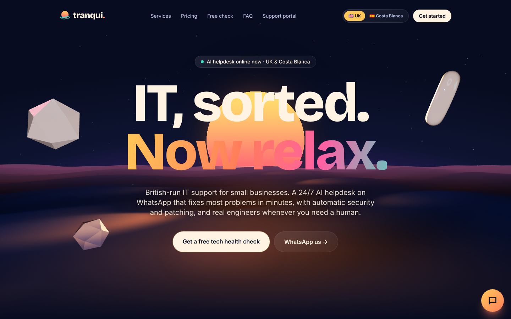
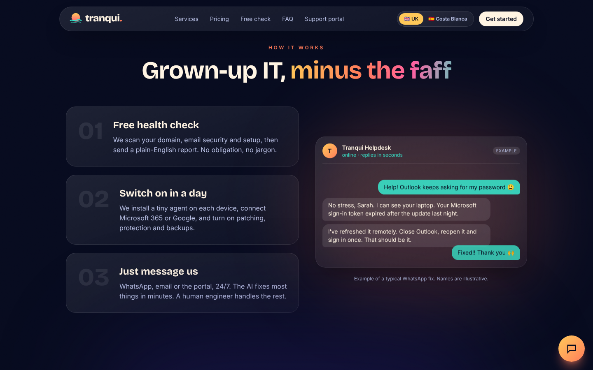
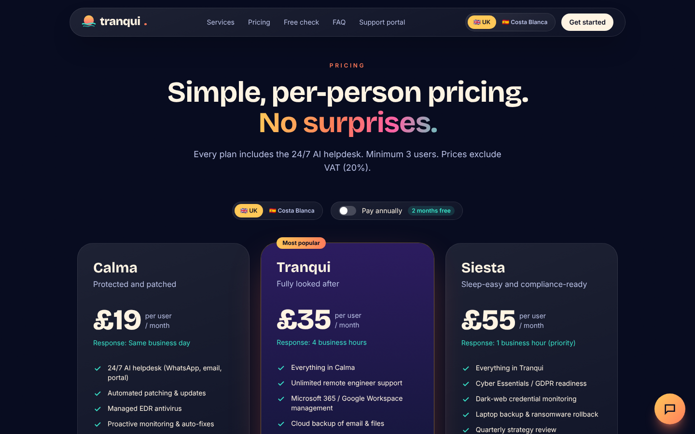

# Tranqui: IT, sorted. Now relax.

An AI-first IT support business for small British-run businesses in the **UK** and on the **Costa Blanca**.

```
tranqui/
├── shared/catalog.json   ← single source of truth: services, plans, prices, terms
├── docs/                 ← strategy, agents, gap analysis, compliance, migration
├── ops/                  ← the agents service (Node + TypeScript + Claude)
└── web/                  ← the website + support portal (Next.js, React Three Fiber, Motion, Tailwind)
```

## Start here

1. [Business blueprint](docs/01-business-blueprint.md): name, positioning, service scope, pricing, unit economics, go-to-market, 90-day plan
2. [The agents](docs/02-agents.md): prospector, outreach, inbound (WhatsApp/email/chat), support, social, digest
3. [Gaps and extra automation](docs/03-gaps-and-extra-automation.md): what the brief missed
4. [Compliance](docs/04-compliance.md): PECR, LSSI, GDPR and Meta/TikTok rules, all enforced in code
5. [patchingguy.com migration](docs/05-patchingguy-migration.md)

## Run locally

```bash
# Agents API + scheduler (http://localhost:8787)
cd ops && cp .env.example .env && npm install && npm test && npm run dev

# Website (http://localhost:3000)
cd web && cp .env.example .env.local && npm install && npm run dev
```

With no API keys set, the channels run in **dev mode**: emails, WhatsApps and social posts are printed to the console instead of being sent. Any agent step that calls Claude needs `ANTHROPIC_API_KEY`.

## Deploy

| Part | Suggested host |
|---|---|
| `web/` | Vercel or Netlify (static + client) |
| `ops/` | Fly.io, Render or a small VPS. It needs a persistent volume for `data/` (SQLite + rendered media) and a public HTTPS URL for the Meta and email webhooks. |

Move to Postgres once you have more than a handful of concurrent users. The SQL is deliberately plain.

## Screenshots




